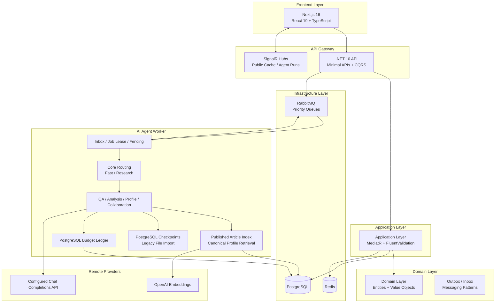

# MrBekoXBlogApp

A modern, full-stack blog platform with AI-powered content assistance, autonomous agent orchestration, and event-driven microservices — built with clean architecture principles.


## Features

- **Content Management**: Create, edit, publish blog posts with markdown and code highlighting support
- **AI-Powered Assistance**:
  - Automatic title, excerpt, and tag generation
  - Content improvement and summarization
  - SEO description and keyword extraction
  - Sentiment analysis and reading time calculation
  - Geographic content optimization
- **Bounded AI Agent**: Versioned background runs, grounded answers, research and explicit collaboration approval
- **Hybrid Article Retrieval**: BM25 + real embedding similarity over PostgreSQL snapshots
- **Real-time Features**: SignalR public-cache invalidation and owner-admitted agent run metadata
- **Chat System**: AI-powered chat with RAG context, abuse protection, and session memory
- **Message Backpressure**: Priority queues, circuit breaker, and graceful degradation
- **Search**: Full-text search with AI-powered ranking
- **SEO**: Automatic sitemap, robots.txt, and structured data
- **Security**: JWT authentication, rate limiting, CSRF protection, input sanitization, Turnstile CAPTCHA

## Architecture



## Tech Stack

### Backend
- **.NET 10** with Clean Architecture (Domain / Application / Infrastructure / API)
- **CQRS** with MediatR + FluentValidation pipeline behaviors
- **Minimal APIs** with route grouping and versioning
- **EF Core** with entity-specific repositories
- **Outbox & Inbox patterns** for reliable event delivery
- **PostgreSQL** as primary database
- **Redis** for optional backend caching and sessions
- **RabbitMQ** for event-driven messaging with priority queues
- **SignalR** for real-time updates (`/hubs/public-cache`, `/hubs/agent-runs`)
- **Serilog** for structured logging
- **OpenTelemetry** for observability

### Frontend
- **Next.js 16** with App Router
- **React 19** with TypeScript
- **TailwindCSS v4** for styling
- **Radix UI** component primitives
- **Zustand** for state management
- **Axios** for HTTP requests
- **@microsoft/signalr v10** for real-time features
- **React Markdown** + `remark-gfm` + `react-syntax-highlighter` for content rendering
- **React Hook Form** + Zod for validation
- **Vitest** for unit testing

### AI Agent Service

- **Python 3.13**, Pydantic and LangGraph with explicit ports/adapters
- **RabbitMQ / aio-pika** for versioned execute, control, content and result messages
- **PostgreSQL / asyncpg** for durable jobs, inbox/outbox, article index, embedding cache and budget reservations
- **Configured remote Chat Completions provider**, with bounded streaming and retries
- **OpenAI `text-embedding-3-small`**, 1536 dimensions, with bounded request splitting
- **Canonical profile snapshots and provenance**, publication/revision checks and verified citations
- **PostgreSQL continuation checkpoints**, with the existing file volume retained for legacy import

Production starts at [`app/service_main.py`](src/services/ai-agent-service/app/service_main.py).
It requires real providers and approved sources; missing configuration fails explicitly.
Legacy local-model, Redis-agent-state and ChromaDB paths are not this production composition.

## AI Agent System

The .NET API accepts an owner-bound run and writes a command outbox. The Python
worker durably accepts the command, leases a job, routes it, executes bounded
model/tool calls and publishes versioned progress/terminal events. The API projects
these events and provides SignalR plus authoritative GET/replay recovery to the browser.

Article QA/analysis use published snapshots. Who am I uses a pinned canonical profile;
profile execution has no web tool capability. Research uses explicitly configured
restricted web tools. Collaboration persists `needs_input` state and accepts only
backend-validated action results after user approval. Optional project/catalogue
guidance requires an authoritative source; a missing source is not replaced with sample data.

| State | Owner / persistence | Guarantee |
| --- | --- | --- |
| Conversation context | Backend snapshot in the execute payload | Owner/session checked at acceptance |
| Run and messages | PostgreSQL jobs and inbox/outbox | Lease/fenced terminal writes; bounded delivery/recovery |
| Continuation | PostgreSQL checkpoint rows; existing volume for legacy import | Stable execution identity and atomic job-fenced writes |
| Paid capacity | PostgreSQL budget reservations | Capacity reserved before calls; uncertain usage is not free |
| Article retrieval | PostgreSQL snapshot/index and embedding cache | Revision/removal guards and bounded article-scoped search |

Job recovery can replay graph work; it does not imply node-level exactly-once
execution. Test and acceptance boundaries are recorded in [`agent-readiness/`](agent-readiness/verification.md).

## Message Backpressure System

Protects against queue overload with:
- **Priority queues** — Critical messages processed first
- **Queue depth monitoring** — `IQueueDepthService` tracks depth in real time
- **Circuit breaker** — Opens when depth exceeds threshold
- **Graceful degradation** — Partial responses returned when overloaded
- **Estimated wait time** — Frontend can display queue status to users

## Domain Model

```
BlogPost      — Title, Slug, Content, Status, IsFeatured, SEO fields, ViewCount
Category      — Name, Slug, Description → many Posts
Tag           — Name, Slug → many Posts (M-M)
User          — Email, PasswordHash, Role (Author / Editor / Admin)
Comment       — PostId, AuthorId, Content
RefreshToken  — UserId, Token, Expiry
OutboxMessage — EventType, Payload, IsProcessed (Outbox pattern)
InboxMessage  — EventType, Payload, IsProcessed (Inbox pattern)
IdempotencyRecord — OperationId, StatusCode, Response
```

## API Endpoints

### Authentication
| Method | Path | Description |
|--------|------|-------------|
| POST | `/api/v1/auth/register` | Register new user |
| POST | `/api/v1/auth/login` | Login (returns JWT) |
| POST | `/api/v1/auth/refresh-token` | Refresh access token |
| POST | `/api/v1/auth/logout` | Logout |

### Posts
| Method | Path | Description |
|--------|------|-------------|
| GET | `/api/v1/posts` | List posts (paginated, search, filter, sort) |
| GET | `/api/v1/posts/featured` | Featured posts |
| GET | `/api/v1/posts/slug/{slug}` | Get post by slug (public) |
| GET | `/api/v1/posts/{id}` | Get post by ID (auth required) |
| POST | `/api/v1/posts` | Create post (draft) |
| PUT | `/api/v1/posts/{id}` | Update post |
| DELETE | `/api/v1/posts/{id}` | Delete post |
| POST | `/api/v1/posts/{id}/publish` | Publish post |
| POST | `/api/v1/posts/{id}/save-draft` | Save draft |

### AI Features
| Method | Path | Description |
|--------|------|-------------|
| POST | `/api/v1/ai/generate-title` | Generate AI title |
| POST | `/api/v1/ai/generate-excerpt` | Generate excerpt |
| POST | `/api/v1/ai/generate-tags` | Generate tags |
| POST | `/api/v1/ai/summarize` | Summarize content |
| POST | `/api/v1/ai/improve-content` | Improve content quality |
| POST | `/api/v1/ai/extract-keywords` | Extract keywords |
| POST | `/api/v1/ai/generate-seo-description` | SEO meta description |
| POST | `/api/v1/ai/analyze-sentiment` | Sentiment analysis |
| POST | `/api/v1/ai/calculate-reading-time` | Reading time |
| POST | `/api/v1/ai/collect-sources` | Collect content sources |
| POST | `/api/v1/ai/geo-optimize` | Geographic optimization |

### Chat
| Method | Path | Description |
|--------|------|-------------|
| POST | `/api/v1/chat/message` | Send chat message |
| GET | `/api/v1/chat/sessions` | Get user sessions |
| GET | `/api/v1/chat/sessions/{id}` | Get session messages |
| DELETE | `/api/v1/chat/sessions/{id}` | Delete session |

### SignalR Hubs
| Hub | Path | Auth | Purpose |
|-----|------|------|---------|
| PublicCacheHub | `/hubs/public-cache` | Anonymous | Cache invalidation broadcasts |
| AgentRunsHub | `/hubs/agent-runs` | Owner/session admission | Versioned metadata hints; authorized GET/replay returns content |

## Caching Strategy

1. **L1 — Redis**: Backend conversation sessions and cached application data
2. **L2 — Local Memory**: Fallback cache for Redis failures
3. **Output Caching**: HTTP response caching on GET endpoints
4. **Cache Invalidation**: Real-time via SignalR `PublicCacheHub`

The production agent's embedding cache and content index are PostgreSQL-backed.

### Cache Keys
- Posts: `posts:list:*`, `posts:slug:*`
- Categories: `categories:list`, `categories:id:*`
- Tags: `tags:list`, `tags:id:*`

## Security Features

- **JWT Authentication** with refresh token rotation
- **Role-Based Access Control** (Author / Editor / Admin)
- **Chat Abuse Protection**: Turnstile CAPTCHA, client fingerprinting, IP rate limiting, session tracking
- **Rate Limiting**: IP-based with configurable rules
- **CSRF Protection**: Anti-forgery tokens for state-changing operations
- **Input Sanitization**: HTML sanitization for user content
- **Service-to-Service Auth**: Internal service key validation
- **Telemetry Privacy**: Application OTLP excludes raw content/auth values; request metadata logs omit query values. Other exception/operator logs need their own access, retention, and privacy review
- **Idempotency**: OperationId-based request deduplication
- **Security Headers**: OWASP recommended headers
- **Password Requirements**: Minimum 12 characters with complexity rules

## Quick Start

### Prerequisites
- Docker and Docker Compose
- .NET 10 SDK (local development)
- Node.js 24 LTS and npm (local development and CI)
- Python 3.13+ (AI service local development)
- Explicit remote chat/embedding configuration and an approved canonical profile for agent execution

### Using Docker for Local Development

```bash
# Clone the repository
git clone https://github.com/MrBekoX/MrBekoXBlogApp.git
cd MrBekoXBlogApp

# Copy environment template
cp docker/.env.example docker/.env

# Edit docker/.env and set required values
nano docker/.env

# Start all services
cd docker && docker compose up -d

# The local Compose configuration enables reviewed API startup migrations.
# Inspect their startup result; the runtime image does not contain the EF CLI.
docker compose logs --tail=100 backend

# Access the application
# Frontend:           http://localhost:3000
# Backend API:        http://localhost:8080
# Swagger UI:         http://localhost:8080/swagger
# RabbitMQ Console:   http://localhost:15672
# Agent progress is exposed by the backend, not a separate worker HTTP API.
```

### Local Development

#### Backend
```bash
cd src/backend/Presentation/API
dotnet restore
dotnet run
```

#### Frontend
```bash
cd src/frontend/blogapp-web
npm install
npm run dev
```

#### AI Agent Service
```bash
cd src/services/ai-agent-service
python -m venv venv
source venv/bin/activate  # Windows: venv\Scripts\activate
python -m pip install --require-hashes -r requirements.lock -r requirements-dev.lock
python -m pip install --no-deps --no-build-isolation -e .
python -m pip check
# Configure the service, provision a dedicated broker/DB and apply reviewed migrations first.
python -m app.service_main
```

## Environment Variables

### Backend (.NET)

| Variable | Description | Required |
|----------|-------------|----------|
| `ConnectionStrings__DefaultConnection` | PostgreSQL connection string | Yes |
| `ConnectionStrings__Redis` | Redis connection string | Yes |
| `JwtSettings__Secret` | JWT signing key (min 32 chars) | Yes |
| `JwtSettings__Issuer` | JWT issuer | No |
| `JwtSettings__Audience` | JWT audience | No |
| `RabbitMq__Host` | RabbitMQ host | Yes |
| `RabbitMq__Port` | RabbitMQ port (default: 5672) | No |
| `RabbitMq__UserName` | RabbitMQ username | Yes |
| `RabbitMq__Password` | RabbitMQ password | Yes |
| `AdminUser__Email` | Admin user email | Yes |
| `AdminUser__Password` | Admin password | Yes |

### Frontend (Next.js)

| Variable | Description | Required |
|----------|-------------|----------|
| `NEXT_PUBLIC_API_URL` | Backend API URL | Yes |
| `NEXT_PUBLIC_SITE_URL` | Site URL for SEO | No |

### AI Agent Service (Python)

> **Config note:** the Python agent service reads its `AGENT_*` variables from a `.env`
> file at `src/services/ai-agent-service` (priority: real environment > `.env` > code
> defaults). Setup: `cp .env.example .env` → fill `AGENT_DB_PASSWORD` and `AGENT_LLM_*`
> → start with `python -m app.service_main`. See
> [`src/services/ai-agent-service/README.md`](src/services/ai-agent-service/README.md).

| Variable | Description | Default | Required |
|----------|-------------|---------|----------|
| `AGENT_LLM_API_KEY` | Remote chat credential | — | Yes |
| `AGENT_LLM_MODEL` | Explicit provider model | — | Yes |
| `AGENT_LLM_BASE_URL` | Chat API base URL | `https://api.openai.com/v1` | No |
| `AGENT_EMBEDDING_API_KEY` | Embedding credential | Chat key fallback | Yes |
| `AGENT_EMBEDDING_MODEL` | Embedding model | `text-embedding-3-small` | No |
| `AGENT_DB_PASSWORD` | Worker PostgreSQL credential | — | Yes |
| `AGENT_BROKER_HOST` | Broker host | `127.0.0.1` | No |
| `AGENT_BROKER_USERNAME` | Least-privilege worker identity | `agent_svc` | Yes in production |
| `AGENT_BROKER_PASSWORD` | Broker credential | Development only | Yes in production |
| `AGENT_CONTENT_BASE_URL` | Backend internal content API | — | Yes |
| `AGENT_CONTENT_SERVICE_KEY` | Internal content credential | — | Yes |
| `AGENT_PROFILE_DIR` | Approved canonical profile directory | Bundled public template | Explicit private mount in production |

The service environment template documents the full settings. Never commit local
environment files, real profile bundles or provider credentials.

## Observability

- **Backend metrics**: internal-host restricted `/metrics`.
- **Backend health**: `/health/live` has no dependency checks; `/health/ready` checks configured DB/cache;
  `/health/agent` reports broker/outbox state without making agent backlog a process liveness failure.
- **Worker health**: `python -m app.healthcheck` checks its supervised heartbeat, without provider calls.
- **Tracing and capacity**: see [verification](agent-readiness/verification.md) for measured coverage.
  A configured trace field or local fixture is not deployment or capacity acceptance.

## Verification

The [AI Agent CI workflow](.github/workflows/ai-agent-ci.yml) is the command source
for .NET/Python unit and real-infrastructure suites, frontend tests/lint/typecheck/build
and browser fixture acceptance. Run .NET and Python broker suites serially, using
dedicated test databases/vhosts and explicit test environment overrides.

```bash
# From src/frontend/blogapp-web
npm ci
npm test
npm run lint
npx --no-install tsc --noEmit
npm run build
npm run test:agent-browser

# From src/services/ai-agent-service, using the installed Python 3.13 environment
python ../../content/author-profile/tools/update_manifest.py --check
python tools/evaluate_grounding.py --check-corpus --scope all
python tools/verify_storage.py
```

The last command creates a disposable PostgreSQL cluster. Offline corpus checks,
transport fixtures, real PostgreSQL/RabbitMQ and a browser with API fixtures each
prove different properties. Real-provider semantic acceptance requires explicit
permission/budget and a dedicated test DB; full-service staging and production
capacity evidence remain separate. See [the service guide](src/services/ai-agent-service/README.md)
and [readiness specification](agent-readiness/spec.md).

## Troubleshooting

### Database Connection Issues
```bash
docker-compose ps postgres
docker-compose logs postgres
```

### AI Service Not Responding
```bash
# Inspect the worker and broker; do not print environment/credential values.
docker compose logs --tail 100 ai-agent
docker compose ps
```

### Redis Connection Errors
```bash
docker-compose ps redis
docker-compose exec redis redis-cli ping
```

### RabbitMQ Queue Issues
```bash
# Check queue depth via management UI
open http://localhost:15672
# Or via CLI
docker-compose exec rabbitmq rabbitmqctl list_queues
```
