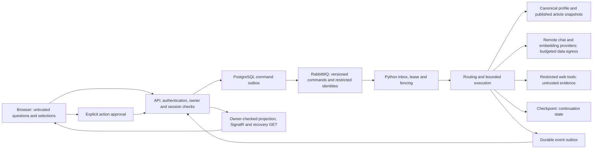

# Agent readiness specification

Evidence date: 2026-10-25. Baseline: `fca834626560829420de9320978c96ad5c71d23d`.
Implementation branch: `codex/agent-industry-readiness`.

This is an engineering acceptance record, not a certification or a maturity percentage.
The production composition is `src/services/ai-agent-service/app/service_main.py`.
Existing Clean Architecture, Python ports/adapters, PostgreSQL, RabbitMQ, Next.js,
SignalR, canonical profile provenance, approval and durable budget controls remain the basis.

## Trust boundaries and execution

Retrieved text and model output supply evidence, never identity, system instructions
or action authority. Backend-validated action results are the only action outcome
accepted by collaboration. No production writes, paid requests, secret operations,
data deletion or main merge are authorized by this acceptance record.

## Requirements and acceptance

| ID / finding | Owner | Given / When / Then | Verification layer |
| --- | --- | --- | --- |
| R01 / F01 | Runtime | Given a new collaboration routed through the worker, when execution starts, then it stores continuation state and returns `needs_input`, rather than `config_error`; a new checkpoint store can resume it. Wrong owner/run, stale/duplicate resume, deadline and cancellation remain rejected. | Worker/entrypoint regression; real DB/control integration |
| R02 / F02 | Runtime/operations | Given worker recovery, when a lease is reclaimed, then terminal effects require the current fence and retries are bounded. Record whether nodes replay; do not claim graph-node recovery without a process restart experiment. | Unit; PostgreSQL/broker; process crash |
| R03 / F03 | Runtime/budget | Given a cache miss or retry, when a paid embedding request starts, then capacity is reserved first, reported usage is distinguished from estimated/uncertain usage, and interrupted usage remains charged. Cache hits make no paid call. Query and indexing ownership are explicit. | Transport/budget; PostgreSQL ledger; paid semantic acceptance separate |
| R04 / F04 | Provider | Given the configured model capability policy, when a request is formed or an SSE stream terminates, then incompatible parameters and malformed/incomplete responses fail explicitly; retry, timeout and cancellation remain bounded. | Transport fixtures; real provider blocked without permission and budget |
| R05 / F05 | Observability | Given a run and an enabled test collector, when API, AMQP and worker execute, then trace parentage is preserved; export failure leaves the run outcome unchanged. No prompt/profile/token/auth values are exported by default and run IDs are not metric labels. | Collector integration; real full chain separately |
| R06 / F06 | RAG/quality | Given versioned public cases, when offline checks run, then schema and expected behavior coverage are validated separately from semantic quality. Live results record commit, provider/model, dataset/prompt versions and actual sample count. Unsupported claims and incorrect citations are measured separately from recall/abstention. | Offline schema/rules; bounded real provider separately |
| R07 / F07 | CI/frontend | Given the production hash lock, when CI installs dependencies, then runtime pins agree and test tooling is reproducible. Given the existing lint rules, when frontend checks run, then lint and typecheck are blocking without added ignores or skipped rules. | Clean installation, lint, typecheck, build, workflow tests |
| R08 / F08 | Integration | Given an approved isolated environment, when a browser submits a run, then real API → broker → worker → provider → projection → SignalR completes, including cancellation, reconnect, publication change and collaboration resume. Fixture success is not this acceptance. | Full service and paid staging acceptance |
| R09 / F09 | Product/data/operations | Given retention policy is not yet selected, when cleanup is designed, then active/resumable records are protected and no invented retention period or production deletion is introduced. Migration artifacts are tested against disposable storage. | Lifecycle inventory; disposable migration tests; product policy pending |
| R10 / F10 | Documentation | Given current composition and commands, when README is read, then active production dependencies and legacy/optional features agree with code. | Source and command review |
| R11 / F11 | Runtime/product | Given a public intent, when production dependencies are composed, then it has an authoritative source or an explicit unavailable capability result; no synthetic project/article records mask missing dependencies. | Production composition and intent regressions |
| R12 / security | Security/API/UI | Given another owner, revoked/expired credentials, untrusted retrieval/tool/model output, replay or a publication change, when access/render/action is attempted, then resource checks and safe rendering still apply. | Independent source-to-sink reviews and focused regressions |
| R13 / F12 | Quality/provider | Given authorized bounded acceptance with a caller-owned HTTP client, when full-pipeline composition constructs embeddings, then its limit hooks are honored, the borrowed client stays caller-owned and production unowned calls remain denied. | Actual acceptance composition with transport fixture; live semantics separate |

## Scope and policy

- Keep active JSON Schema versions and their Python/.NET/TypeScript counterparts compatible.
- Do not replace the agent framework, provider, database or authentication system.
- Preserve production runtime pins unless an explicitly triaged dependency issue requires a bounded change.
- Existing operational policy tooling requires explicit thresholds and recent target evidence.
  No new latency, recall, cost or retention threshold is presented as an industry standard.
- Collaboration terminal recovery retains an optional typed local result receipt. Only an inputless
  recovered claim can reconcile it after all current guards; receipt-less old resolved state is not
  proof of completion. This changes local checkpoint data, not active wire contracts.
- Runtime npm advisories of high/critical severity are a blocking CI gate. Current moderate selector
  parser advisories are assessed against trusted build-time input, as the vendor scopes them.
  Development tooling is audited separately; the selected targeted Vitest 4/Vite 7 upgrade is justified
  by the vendor's lack of 3.x security backports and the existing harness's direct Vite usage.
- Additive migration `0008` is selected for indexing budget ownership, with one runtime writer,
  disposable upgrade/downgrade checks and application rollback that retains the accounting tables.
- Additive migration `0009` makes production checkpoint writes atomic with job fencing in PostgreSQL.
  Existing file checkpoints remain a validated legacy import source and the volume is retained.
  A final independent review and real connection-termination test disproved filesystem fencing based
  only on a live DB row lock. Acceptance now includes connection loss during a paused old write,
  concurrent takeover, first import and restart; neither file mutations nor stale writers may
  override authoritative committed state. Roll-forward is the default recovery policy for this transition.
- Offline, fixture, real infrastructure, real browser, real provider, full service and deployment
  acceptance are separate gates. Missing environment/permission is `BLOCKED`, never `PASS`.

## Source decisions

Official sources were reopened on 2026-10-25; these support control choices, not findings by themselves.

| Source / version | Relevant principle | Requirement / decision |
| --- | --- | --- |
| [NIST AI RMF](https://www.nist.gov/itl/ai-risk-management-framework), current framework page | Identify, measure and manage distinct risks | R01–R12 have owners, acceptance and evidence; no aggregate compliance score |
| [OWASP Agentic Top 10 2026](https://genai.owasp.org/resource/owasp-top-10-for-agentic-applications-for-2026/) | Agent identity, tool and untrusted-data boundaries | R12 source-to-sink checks; preserve existing guards |
| [OpenAI Chat Completions](https://developers.openai.com/api/reference/resources/chat/subresources/completions/methods/create), current API | Parameters vary by model; interrupted SSE can omit final usage | R03/R04 explicit capabilities and conservative uncertain accounting; no API migration |
| [OpenAI evaluation best practices](https://developers.openai.com/api/docs/guides/evaluation-best-practices), current guide | Task-specific datasets, adversarial cases and human calibration | R06 extend local evaluation; example thresholds are not adopted as standards |
| [LangGraph persistence](https://docs.langchain.com/oss/python/langgraph/persistence), installed 1.x constraint | Thread checkpoints differ from application stores | R02 distinguish job recovery and node replay |
| [OpenTelemetry .NET exporters](https://opentelemetry.io/docs/languages/dotnet/exporters/), current guide | Instrumentation must be connected to an exporter | R05 collector proof and exporter failure isolation |
| [OpenTelemetry GenAI repository](https://github.com/open-telemetry/semantic-conventions-genai), current development repository | GenAI conventions evolve separately | R05 pin/record adopted fields and stability; do not capture content |
| [OpenTelemetry Python SDK 1.45.1](https://pypi.org/project/opentelemetry-sdk/1.45.1/), [instrumentation](https://opentelemetry.io/docs/languages/python/instrumentation/) | Explicit SDK/exporters, context and bounded resources | R05 SDK 1.45.1; GenAI guide is Development with core semconv 1.44.0/spec 1.56.0 references |
| [SignalR .NET 10 authentication](https://learn.microsoft.com/en-us/aspnet/core/signalr/authn-and-authz?view=aspnetcore-10.0) | Cached connection principals do not continuously revalidate revocation | R12 expiry closure, invocation/replay checks and metadata-only push |
| [EF applying migrations](https://learn.microsoft.com/en-us/ef/core/managing-schemas/migrations/applying) | Review/test migrations and separate deployment authority | R09 disposable tests; production migration/restore requires its own approved operation |
| [RabbitMQ reliability](https://www.rabbitmq.com/docs/reliability), [confirms](https://www.rabbitmq.com/docs/confirms), current page 4.4; tested server 4.3.6 | Consumer acknowledgement differs from publisher confirmation | R02/R08 bounded delivery/recovery; use actual 4.3.6 tests for version-sensitive behavior |
| [Vitest security advisory](https://github.com/vitest-dev/vitest/security/advisories/GHSA-82fw-gwwq-j7x9), [v4 migration](https://v4.vitest.dev/guide/migration.html) | Older 3.x has no backport; v4 removes tinypool | R07 targeted minimum maintained tooling update, not mismatched internal overrides |
| [Selector parser advisory](https://github.com/postcss/postcss-selector-parser/security/advisories/GHSA-rj75-hqrm-r3gf) | Trusted build-time sources are outside the stated request-path trigger | R07 preserve the parent plugin API and record remaining package warnings accurately |
| [GitHub Actions secure use](https://docs.github.com/en/actions/reference/security/secure-use), [pip secure installs](https://pip.pypa.io/en/stable/topics/secure-installs/) | Least privilege, immutable actions and hashed dependency inputs | R07 preserve action pins/read-only jobs; hash runtime and dev installation together |
| [React external stores](https://react.dev/reference/react/useSyncExternalStore), [state/effect guidance](https://react.dev/learn/you-might-not-need-an-effect) | Hydration snapshots and derived/keyed state preserve render purity | R07/R12 remove synchronous render/effect mutations while retaining recovery/cache guards |
| [Next CSS chunking](https://nextjs.org/docs/app/api-reference/config/next-config-js/cssChunking), [Turbopack](https://nextjs.org/docs/app/api-reference/turbopack), installed16.4.1 | Strict CSS chunk mode is webpack-only; Turbopack is the existing default | R07 remove incompatible option, retain bundler/type gates, verify production build |

Context7 and an actual Plan Mode toggle were not available. A written executable plan is maintained.

## Data lifecycle and retention decisions

No product-wide retention duration or legal requirement has been selected. The table records
ownership and safe cleanup constraints; it does not authorize deletion or invent a number of days.

| Data | Owner / current persistence | Cleanup / anonymization constraint | Current decision |
| --- | --- | --- | --- |
| Run question, selected context, conversation and result | Backend `AgentRun` / PostgreSQL | Keep active, queued and resumable records; terminal policy must cover authorized audit/export and owner deletion | Product retention period pending; no automatic bulk deletion |
| Action proposal, approval and validated result | Backend proposal/run records and worker checkpoint | Keep proposal identity/hash and replay guards while any continuation/retry remains possible | Retain with parent workflow until explicit lifecycle policy |
| Command/event inbox and outbox payload | Backend and Python message stores | Acknowledge/relay first; retain dedupe identity beyond the supported redelivery/recovery window; avoid raw payload in logs | Delivery-window/product policy pending |
| Run budget ledger and outstanding reservations | Python PostgreSQL, run/fence-bound | Never refund or discard uncertain/reserved charges on restart; account before deleting the parent job | Retain through recovery and accounting review |
| Content indexing budget ledger | Python PostgreSQL, revision/model-bound | Duplicate delivery must not receive new capacity; preserve orphan reservations as charges | Additive persisted owner; cleanup policy pending |
| Article index and embedding cache | Python PostgreSQL | Publication/removal/revision guards must prevent stale retrieval; cached vectors do not grant article authority | Existing tombstone/revision guards retained; expiry policy separate |
| Canonical profile and snapshot provenance | Approved read-only bundle, backend payload/checkpoint snapshot reference | Do not copy private source into telemetry, Git or evaluation corpus; retain referenced snapshot for valid continuation or reject it explicitly | Existing snapshot/hash checks retained |
| Continuation checkpoint | PostgreSQL job checkpoint rows after migration 0009; existing worker volume for legacy import | Opaque payload includes question/history/collaboration details; job FK cascade affects deletion and DB backup scope. Preserve active/resumable state and execution identity; legacy files cannot override imported DB state | No TTL/cleanup invented; production downgrade requires quiesced explicit recovery |
| Telemetry and application logs | Operator/exporter storage | Application exporters exclude prompt/result/profile/auth and request metadata omits query values; other exception/operator logs need separate privacy/access review | Bounded application exporter tested; no universal log redaction or retention policy claimed |
| DB/volume backups | Operator-owned backup system | Include the above retention/deletion effects in restore; backup age and restoration must be measured in target environment | Backup/restore drill not yet evidenced |

A future cleanup job should select only terminal, nonresumable parents with no pending outbox,
live proposal, lease or unresolved accounting; use bounded batches and transactions, retain a
minimal non-PII dedupe/audit identity when required, and verify a restore before production rollout.
Do not run that job until product retention and operator backup policies are explicit.

## Author and critic decisions

Author: root orchestrator, supported by runtime and integration specialists and their workers.
Initial independent runtime worker confirmed F01 and the F02 recovery boundary.
Critic decisions and revisions are recorded in `findings.md` as the implementation evolves.
